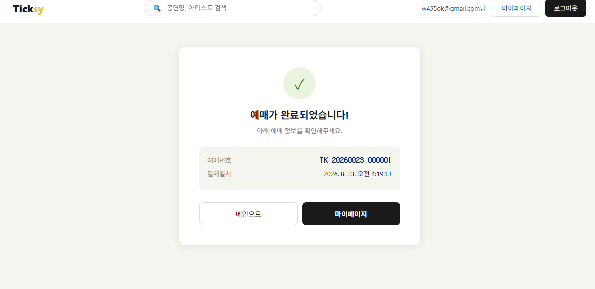

# 2. 결제 승인 API 중복 호출과 서버 측 검증 보완

## 문제상황

Toss Payments 결제 완료 후 `/payment/complete` 페이지로 리다이렉트될 때, 해당 페이지에서 호출하는 `POST /payments/confirm` 결제 승인 API가 연속 2회 호출되는 현상이 발생했습니다.

```
결제 완료 → /payment/complete 진입
    → confirmPayment 1번 호출 → 예매 저장 성공
    → confirmPayment 2번 호출 → 예매 중복 삽입 또는 에러
```

결제 승인 API는 Toss 서버에 승인을 요청하고 DB에 예매/결제 데이터를 저장하는 부수 효과(Side Effect)가 있습니다.<br>
중복 호출되면 같은 주문이 두 번 처리될 위험이 있습니다.

## 원인

React StrictMode가 개발 환경에서 `useEffect`를 의도적으로 2번 실행했습니다.

```tsx
// PaymentCompletePage.tsx
useEffect(() => {
  handleConfirm(paymentKey, orderId, Number(amount)); // 2번 실행됨
}, []);
```

직접적인 원인은 개발 환경의 프론트엔드 동작이었지만, 운영 환경에서도 새로고침이나 네트워크 재시도로 같은 승인 요청이 다시 들어올 수 있습니다.<br>
따라서 클라이언트에서 막는 것과 별개로, **서버가 잘못된 승인 요청을 걸러낼 수 있는지**도 함께 점검했습니다.

## 해결 과정

### 1. 클라이언트: useRef로 중복 실행 방지

```tsx
// 수정 전 - 2번 실행됨
useEffect(() => {
  const paymentKey = searchParams.get('paymentKey');
  const orderId = searchParams.get('orderId');
  const amount = searchParams.get('amount');

  handleConfirm(paymentKey, orderId, Number(amount));
}, []);
```

```tsx
// 수정 후 - useRef로 중복 실행 방지
const calledRef = useRef(false);

useEffect(() => {
  // 이미 호출됐으면 즉시 종료
  if (calledRef.current) return;
  calledRef.current = true;

  const paymentKey = searchParams.get('paymentKey');
  const orderId = searchParams.get('orderId');
  const amount = searchParams.get('amount');

  if (!paymentKey || !orderId || !amount) {
    setError('결제 정보가 올바르지 않습니다.');
    setLoading(false);
    return;
  }

  handleConfirm(paymentKey, orderId, Number(amount));
}, []);
```

### useRef를 선택한 이유

```
StrictMode는 리렌더링 없이 `useEffect`를 연달아 두 번 실행합니다.
`useState`는 값을 바꿔도 다음 렌더링 때 반영되므로, 두 번째 실행 시점에는 여전히 이전 값(`false`)이 보여 중복을 막을 수 없습니다.
반면 `useRef`의 `.current`는 바꾸는 즉시 반영되어 두 번째 실행에서 바로 확인할 수 있습니다.
```

### 2. 서버: 주문 식별 기준을 서버로 통일

orderId를 클라이언트가 아닌 서버에서 생성해 결제 요청 응답으로 전달하도록 했습니다.<br>
결제 요청 시 orderId에 해당하는 회차, 좌석 정보를 Redis에 저장(TTL 10분)해 두고, 승인 요청은 이 orderId를 기준으로만 처리합니다.

### 3. 서버: 결제 승인 전 금액과 선점 상태 재검증

기존에는 결제 **요청** 단계에서만 금액을 검증하고, 결제 **승인** 단계에서는 클라이언트가 보낸 금액을 그대로 Toss에 전달하고 있었습니다. <br>
요청 때는 정상 금액을 보내고 승인 때 금액을 바꿔 보내면 막을 수 없는 구조였습니다.

- 결제 요청 시 서버가 DB 가격으로 계산한 금액을 Redis 주문 정보에 함께 저장
- 결제 승인 시 저장된 금액과 승인 요청 금액을 비교해, 다르면 **Toss 승인 API를 호출하기 전에** `PRICE_MISMATCH`로 차단
- 좌석 선점이 만료됐거나 본인 선점이 아니면 `SEAT_HOLD_EXPIRED`로 차단

```java
// ReservationService.confirmPayment()
Integer expectedAmount = Integer.parseInt(parts[2]);

if (!expectedAmount.equals(request.getAmount())) {
    log.warn("결제 금액 불일치: orderId={}, expected={}, requested={}",
            request.getOrderId(), expectedAmount, request.getAmount());
    throw new CustomException(ErrorCode.PRICE_MISMATCH);
}
```

## 결과

현재 중복 승인 요청은 클라이언트(useRef)에서만 막고 있습니다. <br>
같은 orderId로 승인 요청이 거의 동시에 두 번 들어오면, Redis 주문 정보가 처리 마지막에 삭제되기 때문에 두 요청이 모두 검증을 통과할 수 있습니다.

