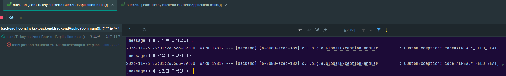
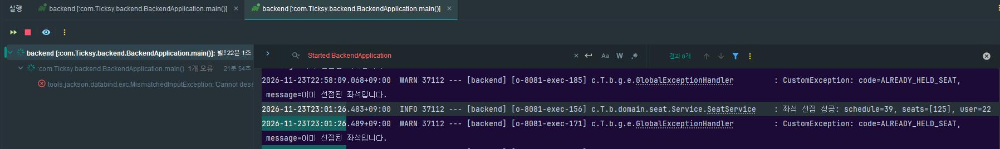
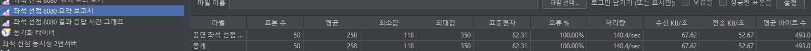
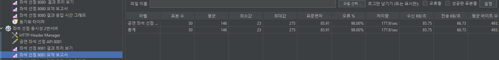

# 1. 좌석 선점 동시성 문제

## 문제 상황
A와 B가 거의 동시에 "이 좌석 비어 있나?"를 확인하면 둘 다 "비어있다"고 판단해 중복 선점이 발생했습니다.<br>
좌석 선점은 "이 좌석이 비어 있는지 확인 → 비어 있으면 Redis에 선점 저장" 순서로 동작합니다. <br>
좌석 선점은 해당 좌석이 비어 있는지 확인 -> 비어 있으면 Redis에 선점 저장 순서로 동작합니다. <br>


```
A 요청: "1행 1열 비어 있나?" → 비어 있음 확인
B 요청: "1행 1열 비어 있나?" → 비어 있음 확인  ← A가 저장하기 전에 확인
A 요청: Redis에 선점 저장
B 요청: Redis에 선점 저장  ← 중복 선점 발생
```

티켓팅은 오픈 직후 같은 좌석에 요청이 몰리는 서비스라 이 상황을 반드시 막아야 합니다.

## 원인

`hasKey` 확인과 `SET` 저장이 각각 따로 실행되는 명령이라 원자적이지 않습니다. <br>
명령 하나하나는 안전하지만 두 명령 사이에 다른 요청이 들어올 수 있습니다. <br>

### 락 방식 선택

고려한 방법은 세 가지였습니다.

| 방법 | 선택하지 않은/선택한 이유 |
|---|---|
| `synchronized` (JVM 락) | 서버 한 대 안에서만 동작합니다. 서버가 두 대가 되면 서로의 락을 모릅니다. |
| DB 비관적 락 (Bid&Buy에서 사용) | 선점 상태는 DB가 아니라 Redis에 저장합니다. DB 행에 락을 걸어도 Redis 키를 직접 보호하지 못하고, 선점 요청마다 DB 트랜잭션이 필요해집니다. |
| **Redisson 분산 락** | 선점 데이터와 같은 Redis에서 락을 관리하고, 여러 서버가 같은 락을 공유할 수 있습니다. |

Bid&Buy에서는 서버 한 대, DB 한 개를 전제로 비관적 락을 썼습니다. <br>
이번에는 서버가 늘어나도 동작하는 방식을 직접 확인해 보고 싶어서 Redisson을 선택했습니다.

## 해결 과정 

좌석 하나마다 락을 따로 걸어서, 같은 좌석에 대해서는 한 번에 한 요청만 "확인" -> "저장"을 하도록 했습니다. <br>
좌석 단위로 나눈 이유는 서로 다른 좌석을 고르는 사용자끼리 기다릴 필요가 없기 때문입니다.

### Redis 키 설계
```
  선점 키: seat:hold:{scheduleId}:{seatId} → userId (TTL 5분)
  락 키: lock:hold:{scheduleId}:{seatId} → Redisson RLock
```

선점 키에 TTL 5분을 둔 건 결제하지 않고 나간 사용자의 좌석이 계속 잡혀 있지 않게 하려는 목적입니다.

### 좌석 선점 코드(SeatHoldService.tryHoldSeat)
```java
public boolean tryHoldSeat(Long scheduleId, Long seatId, Long userId) {
    String lockKey = LOCK_PREFIX + scheduleId + ":" + seatId;
    RLock lock = redissonClient.getLock(lockKey);

    try {
        // 락 획득 시도 (대기 3초, 점유 3초)
        boolean acquired = lock.tryLock(3, 3, TimeUnit.SECONDS);

        if (!acquired) {
            return false; // 락 획득 실패 → 선점 실패
        }

        // 락 획득 성공 → 이미 선점됐는지 확인
        String holdKey = SEAT_HOLD_PREFIX + scheduleId + ":" + seatId;
        if (Boolean.TRUE.equals(redisTemplate.hasKey(holdKey))) {
            return false; // 이미 선점됨
        }

        // 선점 처리 (TTL 5분)
        redisTemplate.opsForValue().set(holdKey, String.valueOf(userId), 5, TimeUnit.MINUTES);
        return true;

    } catch (InterruptedException e) {
        Thread.currentThread().interrupt();
        throw new CustomException(ErrorCode.INTERNAL_SERVER_ERROR);
    } finally {
        if (lock.isHeldByCurrentThread()) {
            lock.unlock(); // 반드시 해제
        }
    }
}
```

위 메서드에서 `false`가 반환되면 `SeatService`에서 `ALREADY_HELD_SEAT` 예외로 응답합니다. <br>
여러 좌석을 한 번에 요청했다면 앞에서 선점한 좌석도 함께 취소합니다.

### 좌석 상태 판단 로직

```java
public static SeatItemResponse of(SeatEntity seat, boolean isHolding) {
    String status;
    if (seat.getStatus().name().equals("RESERVED")) {
        status = "RESERVED";   // DB 기준 - 예매 완료
    } else if (isHolding) {
        status = "HOLDING";    // Redis 기준 - 선점 중 (TTL 5분)
    } else {
        status = "AVAILABLE";  // 선택 가능
    }
    return SeatItemResponse.builder()
            .seatId(seat.getSeatId())
            .rowNum(seat.getRowNum())
            .colNum(seat.getColNum())
            .status(status)
            .build();
}
```
### 선점 흐름

```
같은 좌석에 동시 요청 100건 (8080: 50건 / 8081: 50건)
        ↓
좌석 락 획득 시도 (최대 3초 대기)
        ↓
┌─ 가장 먼저 락 획득한 요청
│     선점 키 없음 → 저장 (TTL 5분) → 성공 → 락 해제
│
├─ 그다음 락을 획득한 요청들 (순서대로)
│     선점 키 있음 → 실패 (ALREADY_HELD_SEAT) → 락 해제
│
└─ 3초 안에 락을 얻지 못한 요청
      → 실패 (ALREADY_HELD_SEAT)
```

## 결과

### 테스트 환경

- 같은 애플리케이션을 포트만 바꿔 2대 실행 (8080, 8081)
- 두 서버는 같은 Redis와 MySQL 사용
- JMeter Thread Group 2개(서버당 50명, Ramp-up 0, Synchronizing Timer로 동시에 요청)

같은 회차의 같은 좌석 1개

  | 회차 | 총 요청 | 성공 | 실패 | 성공한 서버 |
  |---|---|---|---|---|
  | 1 | 100 | 1 | 99 | 8081 |

### 8080 서버 로그


### 8081 서버 로그


### JMeter 8080 결과


### JMeter 8081 결과
