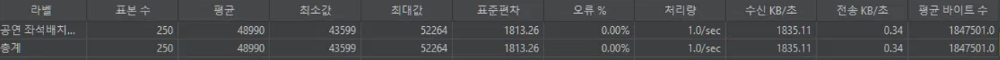
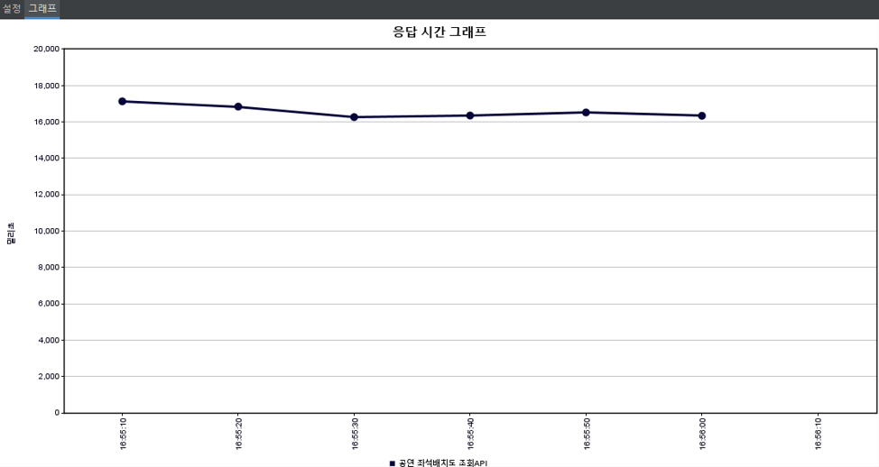
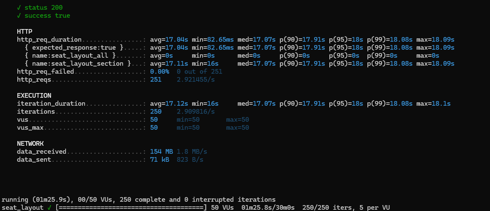
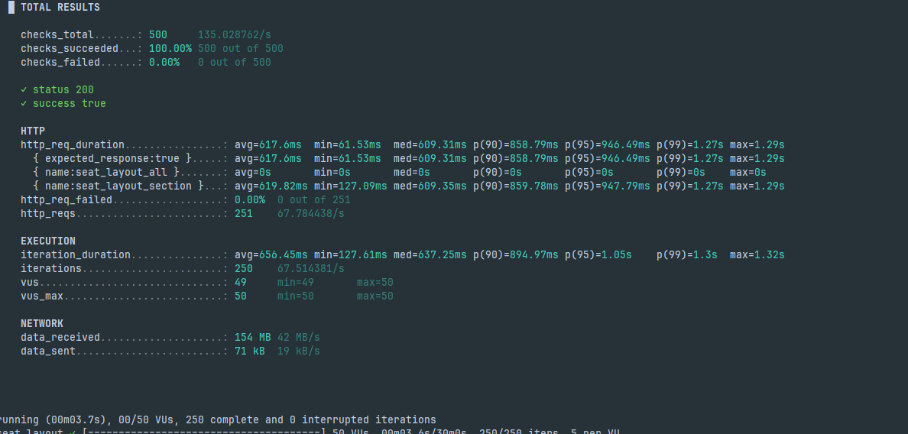

# 좌석 배치도 조회 성능 저하 문제

## 문제 상황

처음에는 좌석 30,000개를 한 번에 내려주는 구조였고, JMeter로 측정했을 때 평균이 48초가 넘었습니다. <br>
그래서 인터파크나 멜론티켓처럼 구역 탭을 눌렀을 때 그 구역 좌석만 가져오도록 API를 바꿨습니다.




```
변경 전: GET /seats              → 전체 30,000석
변경 후: GET /seats?sectionId=1  → A구역 10,000석
```

좌석 배치도 조회 API가 구역 하나(10,000석)를 조회하는 데 평균 17.5초가 걸렸습니다. <br>
예매 오픈처럼 사용자가 몰리는 순간에는 사실상 쓸 수 없는 상태였습니다.




### 인덱스 추가


```sql
-- 좌석 배치도 조회 핵심 인덱스
CREATE INDEX idx_section_id ON seats(section_id);
CREATE INDEX idx_schedule_id ON sections(schedule_id);

-- 공연 목록 조회
CREATE INDEX idx_concert_id ON event_schedules(concert_id);
CREATE INDEX idx_venue_id ON concerts(venue_id);

-- 예매/결제 조회
CREATE INDEX idx_user_id ON reservations(user_id);
CREATE INDEX idx_res_schedule_id ON reservations(schedule_id);
CREATE INDEX idx_reservation_id ON payments(reservation_id);
```

응답 데이터가 3분의 1로 줄어서 시간도 절반 정도로 줄었고 이후에 인덱스를 추가해서 16초대까지 내려 갔습니다. <br>
하지만 16초도 여전히 느렸고 무엇보다 "인덱스를 추가해서 빨라졌다"는 결과를 제대로 설명하지 못한다는 게 마음에 걸렸습니다. <br>
그래서 측정부터 다시 하기 했습니다.

### 측정 방법

이전에는 JMeter를 썼는데, 이번에는 시나리오를 코드로 남기고 같은 조건으로 반복해서 돌리기 위해 k6로 바꿨습니다. 조건은 비교가 가능하도록 이전 JMeter 측정과 똑같이 맞췄습니다.

- 50명(VU)이 각각 5번씩, 총 250번 요청
- 회차 1개에 구역 3개, 구역마다 10,000석 (시드 SQL로 매번 같은 데이터를 만들 수 있게 함)
- SQL 로그 출력은 측정에 영향을 줄 수 있어서 측정용 프로파일(perf)에서는 끔ㅋ

## 개선 전 측정 결과



| 평균 | 중앙값 | p95 | p99 | TPS |
|---|---|---|---|---|
| 17.11s | 17.07s | 18.00s | 18.08s | 2.91 |


## 원인

1. section_id 인덱스가 없어서 seats 테이블을 전부 읽고 있다
2. 10,000개짜리 응답을 JSON으로 바꾸는 데 시간이 오래 걸린다

### 구간별로 시간 재기
SeatService에 Spring의 StopWatch를 넣어서 DB 조회, Redis 조회, DTO 변환 시간을 따로 기록했습니다. <br>
JSON 변환까지 포함한 서버 전체 시간은 필터를 하나 만들어서 따로 쟀습니다.

```java
StopWatch sw = new StopWatch("seatLayout");

sw.start("2. 구역+좌석 조회 (DB, fetch join)");
sections = sectionRepository.findWithSeatsBySectionId(scheduleId, sectionId);
sw.stop();

sw.start("3. 선점 상태 조회 (Redis, 좌석마다 1회)");
// ...
sw.stop();

log.info("[PERF] seatLayout ... serviceMs={}\n{}", sw.getTotalTimeMillis(), sw.prettyPrint(TimeUnit.MILLISECONDS));
```
### 로그 

```java
[PERF] seatLayout scheduleId=39 sectionId=124 seats=10000 redisCalls=10000 serviceMs=18755
Milliseconds  %       Task name
-----------------------------------------------
00045.934     00%     1. 회차 조회 (DB)
00705.5514    04%     2. 구역+좌석 조회 (DB, fetch join)
17875.0461    95%     3. 선점 상태 조회 (Redis, 좌석마다 1회)
00010.5373    00%     4. DTO 변환
00118.8068    01%     5. 탭용 구역 목록 조회 (DB)

[PERF] serverMs=19027 status=200 uri=/concerts/1/schedules/39/seats?sectionId=124
```

시간의 95%가 Redis 구간이었습니다. 의심했던 DB는 다 합쳐도 5% 정도였고, 서버 전체 시간(19,027ms)에서 <br> 서비스 시간(18,755ms)을 빼면 JSON 변환과 트랜잭션 커밋에 쓴 시간은 270ms 정도였습니다.

## 왜 Redis가 이렇게 느렸나
좌석이 선점됐는지는 Redis에 seat:hold:{scheduleId}:{seatId} 키가 있는지로 판단합니다. <br>
그런데 기존 코드는 응답을 만들면서 좌석 하나마다 hasKey를 호출하고 있었습니다.

```java
// 기존 코드
section.getSeats().stream()
        .map(seat -> {
            boolean isHolding = seatHoldService.isHolding(scheduleId, seat.getSeatId());
            return SeatItemResponse.of(seat, isHolding);
        })
        .toList();
```

좌석이 10,000개면 요청 한 번에 Redis를 10,000번 왕복하고, 50명이 동시에 요청하면 50만 번이 됩니다. <br> 
여기에 Spring Data Redis가 기본으로 쓰는 Lettuce는 연결 하나를 여러 스레드가 같이 쓰기 때문에, 이 명령들이 결국 한 줄로 처리됩니다. <br>
1명일 때는 1초 남짓이던 요청이 50명일 때 17초가 된거였습니다.

초당 2.86건을 처리했으니 Redis는 초당 약 29,000번 호출된 셈이고, 로컬 Redis 왕복 시간과 비슷했습니다.

DB에서 N+1 문제가 Redis에서도 똑같이 생길 수 있다는 걸 이번에 처음 알게 됐습니다.

## 해결 과정

### 1단계 — 다시 측정할 수 있는 환경부터 만들기

원인을 찾는 것만큼 "고친 다음에 같은 조건으로 다시 잴 수 있는가"가 중요하다고 생각해서, 측정 환경을 먼저 정리했습니다.

- perf/k6/seat-layout.js : 로그인해서 받은 토큰으로 좌석 조회. 결과에서 로그인 요청은 빼고 조회 API만 따로 보이게 함
- perf/seed/seed-30000-seats.sql : 몇 번을 실행해도 같은 30,000석 데이터가 만들어지는 시드
- application-perf.yml : SQL 로그와 data.sql 재실행 끄기
- StopWatch, RequestTimingFilter : 구간별 시간과 서버 전체 시간 기록


### 2단계Redis 조회를 MGET 한 번으로 바꾸기

```java
// SeatHoldService
public Map<Long, Boolean> getHoldingStatus(Long scheduleId, List<Long> seatIds) {
    Map<Long, Boolean> result = new HashMap<>();
    if (seatIds.isEmpty()) {
        return result;
    }

    List<String> keys = seatIds.stream()
            .map(seatId -> SEAT_HOLD_PREFIX + scheduleId + ":" + seatId)
            .toList();

    List<String> values = redisTemplate.opsForValue().multiGet(keys);

    for (int i = 0; i < seatIds.size(); i++) {
        result.put(seatIds.get(i), values != null && values.get(i) != null);
    }
    return result;
}
```


```java
// SeatService
List<Long> seatIds = sections.stream()
                .flatMap(section -> section.getSeats().stream())
                .map(SeatEntity::getSeatId)
                .toList();
Map<Long, Boolean> holdingBySeatId = seatHoldService.getHoldingStatus(scheduleId, seatIds);
```
응답 내용은 그대로이고, 요청당 Redis 왕복만 10,000번에서 1번으로 줄었습니다. <br>
이 변경이 얼마나 효과가 있는지 정확히 보고 싶어서, 다른 수정은 섞지 않고 이것만 바꾼 상태로 측정했습니다.
---

## 결과
같은 조건(구역 10,000석, 50명 × 5번)으로 다시 측정했습니다.


| | 개선 전 | MGET 적용 후 |
|---|---|---|
| 평균 | 17.52s | 0.62s |
| 중앙값 | 17.42s | 0.61s |
| p95 | 18.37s | 0.95s |
| p99 | 18.42s | 1.27s |
| TPS | 2.86 | 67.8 |
| 실패율 | 0% | 0% |



